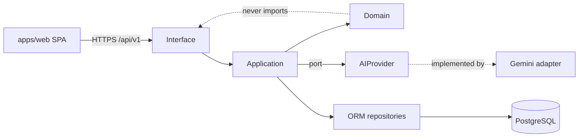
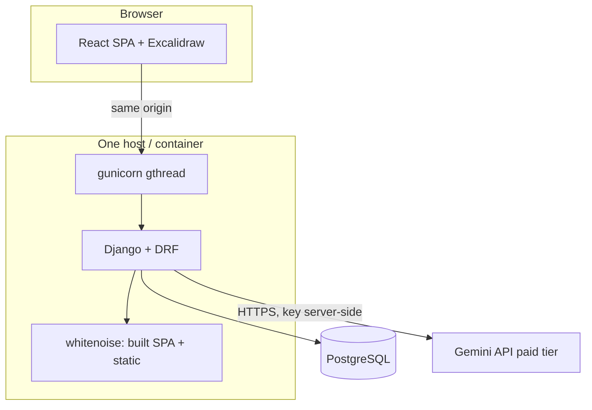
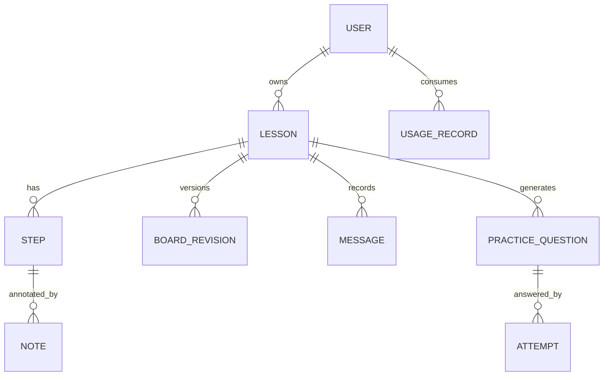

# Architecture Spine: Whiteboard Tutor

## Design Paradigm

Modular monolith, ports-and-adapters. One deployable Django service plus one SPA. The teaching domain is pure Python with no Django or SDK imports; it talks to the outside through ports (`AIProvider`, `Clock`), and Django views, ORM repositories and the Gemini SDK are adapters.

| Layer | Location | May import |
| --- | --- | --- |
| Interface (DRF views, serializers) | `apps/api/<app>/api/` | application, domain |
| Application (use cases, orchestrator, usage/allowance) | `apps/api/<app>/services/` | domain, ports |
| Domain (schemas, Board Operation validation, layout, step model) | `apps/api/<app>/domain/` | stdlib, pydantic |
| Adapters (ORM models, Gemini provider) | `apps/api/<app>/models.py`, `apps/api/ai/providers/` | domain, ports |

## Invariants & Rules



### AD-1 — Domain is framework-free
- **Binds:** FR-2, FR-6, FR-7, FR-8
- **Prevents:** teaching rules leaking into views or the Gemini SDK, blocking a second provider (high-school phase).
- **Rule:** `domain/` imports only stdlib and pydantic. `google.genai` is imported only in `ai/providers/gemini.py`. Nothing outside `ai/providers/` names a model or vendor.

### AD-2 — The model never controls the Board directly
- **Binds:** FR-6, FR-8, FR-4
- **Prevents:** raw Excalidraw JSON, HTML or JS from AI output reaching the Board.
- **Rule:** The provider returns data validated against the versioned `LessonStep` schema, whose Board part is a list of `BoardOperation`s from a closed vocabulary (`add_element`, `update_element`, `remove_element`, `highlight_element`, `set_viewport`). The server validates types, ids, coordinates, sizes, text length, colours and counts against fixed limits. The frontend applies operations only through one typed adapter. Invalid output is rejected whole, never partially applied.

### AD-3 — Learner Content is untouchable by AI
- **Binds:** FR-1, FR-4
- **Prevents:** AI updates deleting or moving a learner's work.
- **Rule:** Every element carries `customData.origin` in {`ai`, `learner`} and a stable `customData.stepId`. Operations targeting `origin=learner` elements are rejected by the validator. AI-created ids are server-assigned and namespaced `ai:<stepId>:<n>`.

### AD-4 — Board saves are revisioned and optimistic
- **Binds:** FR-10, FR-9
- **Prevents:** a stale autosave overwriting newer work; lost state after interrupted generation.
- **Rule:** `BoardRevision` rows are append-only with a per-lesson integer `revision`. Writes send the base revision; the server rejects a mismatch with 409 and the current revision. Generation writes a revision only after full validation, inside one transaction. Old revisions are pruned by policy, never by update.

### AD-5 — Ownership on every query
- **Binds:** FR-15, FR-16, FR-17, FR-18
- **Prevents:** cross-user access; client-supplied user ids trusted.
- **Rule:** Every owned model has an `owner` FK. Views obtain querysets only through owner-scoped managers (`Model.objects.for_user(request.user)`); foreign ids return 404. The owner is always `request.user`, never a request field.

### AD-6 — Session auth, same origin
- **Binds:** FR-15
- **Prevents:** tokens in browser storage; CORS/CSRF drift.
- **Rule:** Django session cookie (HttpOnly, Secure, SameSite=Lax) plus CSRF for unsafe methods. Production serves the built SPA and API from one origin. Dev uses the Vite proxy. The `18+` confirmation is stored with a timestamp at registration and required for it.

### AD-7 — Generation is synchronous, bounded, charged first
- **Binds:** FR-2, FR-9, FR-17
- **Prevents:** runaway spend and hung workers; double charging.
- **Rule:** One generation = one request. Order: check and charge allowance (per-user and global) in one transaction, then call the provider with a hard timeout and a bounded retry count for transient/format failures, then validate, then persist. Provider failure refunds the charge and writes no revision. A per-process semaphore bounds concurrent provider calls. No Celery/Redis in v1. Cancel is client abort; the server treats a disconnected generation as failed and refunds.

### AD-8 — Steps are generated incrementally
- **Binds:** FR-2, FR-3, FR-4
- **Prevents:** regenerating whole lessons per follow-up; unbounded output.
- **Rule:** A plan call returns Step outlines; each Step is generated by its own call using the plan plus a bounded context window. A follow-up generates only the affected Step(s). Plan size and per-Step operation counts have fixed caps.

### AD-9 — Prompts and schemas are versioned code
- **Binds:** FR-6, FR-7
- **Prevents:** untestable prompt drift; model name sprawl.
- **Rule:** Prompts and JSON schemas live in `ai/prompts/v<n>/` and `domain/schemas/v<n>/`. Stored records keep `schema_version`. The model id is read only from `GEMINI_MODEL`. User text, pasted code and model output are treated as untrusted and are never concatenated into system instructions.

### AD-10 — Computed facts are computed
- **Binds:** FR-5
- **Prevents:** presenting unchecked model arithmetic as verified.
- **Rule:** Results marked `verified` come only from deterministic evaluators in `domain/verify/` (arithmetic/algebra in v1). Unverified model claims carry no verified marker.

### AD-11 — Failure never fabricates
- **Binds:** FR-6, FR-9
- **Prevents:** fake success or fallback explanations.
- **Rule:** On provider error, quota exhaustion, timeout or validation failure, the API returns a typed error (`code`, `message`, `retryable`, `request_id`), leaves the Lesson and Board unchanged, and the UI offers retry.

### AD-12 — Tests never call Gemini
- **Binds:** all
- **Prevents:** paid or flaky CI.
- **Rule:** Automated tests use a `FakeProvider` implementing the `AIProvider` port with fixtures (valid, malformed, oversized, repeated, partial). Live-provider tests are marked `live` and excluded from CI by default.

## Consistency Conventions

| Concern | Convention |
| --- | --- |
| Naming | Django apps and Python modules `snake_case`; React components `PascalCase`; API JSON fields `snake_case`; Board Operation `type` values as listed in AD-2 |
| Ids and dates | Lesson, Step and Revision ids are UUIDv7-style or UUID4 strings; timestamps UTC ISO 8601; revisions are integers |
| API | Prefix `/api/v1/`; DRF pagination on collections; OpenAPI via drf-spectacular is the contract; the web client types are generated from it |
| Errors | Single envelope `{ "error": { "code", "message", "retryable", "request_id" } }`; no tracebacks; codes are stable strings |
| Logging | Structured JSON with `request_id`; no prompts, student content, passwords or keys logged by default |
| Config | Environment variables via django-environ; no secrets in the repo; `.env.example` only |
| Frontend state | Server state through one query layer; Board state lives in Excalidraw, serialized only on debounced save and on step change |
| Limits | All size, count and rate limits are named constants in one `limits` module per side, mirrored by tests |
| Tests | Backend pytest + FakeProvider; frontend Vitest + Testing Library; Playwright for the critical journey with the API's provider replaced by the fake |

## Stack

| Name | Version |
| --- | --- |
| Python | 3.13 |
| Django | 6.1.2 |
| Django REST Framework | 3.18.3 |
| drf-spectacular | 0.30.0 |
| psycopg | 3.3.6 |
| google-genai | 2.33.0 |
| pydantic | 2.14.1 |
| gunicorn | 26.2.0 |
| whitenoise | 6.12.0 |
| PostgreSQL | 18 (local 18.6) |
| React | 19.3.1 |
| Vite | 8.3.5 |
| @excalidraw/excalidraw | 0.18.1 |
| Vitest | 5.0.5 |
| TypeScript | pin after toolchain check (registry latest 7.0.2 unverified with ecosystem) |

## Structural Seed





```text
apps/
  api/
    config/            # settings, urls
    core/              # health, request id, error envelope, limits
    accounts/          # users, 18+ confirmation, preferences
    lessons/           # lessons, steps, messages, notes, library
    board/             # BoardRevision, operation schema + validator, layout
    teaching/          # orchestrator, modes, plan/step use cases
    ai/                # AIProvider port, providers/gemini.py, prompts/v1, FakeProvider
    practice/          # questions, attempts
    usage/             # allowance, global ceiling, UsageRecord
  web/                 # React SPA: routes, board adapter, workspace
packages/shared/       # generated API types only
docs/                  # implementation docs
```

Environments: `dev` (Vite proxy, local PostgreSQL), `test` (`config.settings_test`, FakeProvider), `prod` (DEBUG off, Secure cookies, HSTS, one container behind HTTPS, secrets from the platform). Backups via `pg_dump`.

## Capability → Architecture Map

| Capability / Area | Lives in | Governed by |
| --- | --- | --- |
| FR-1 Interactive Board | `web` board adapter | AD-2, AD-3 |
| FR-2 to FR-4, FR-7 Teaching | `teaching`, `ai` | AD-1, AD-7, AD-8, AD-9 |
| FR-5 Math and code | `web`, `domain/verify` | AD-10 |
| FR-6, FR-9 Validation and recovery | `board`, `teaching` | AD-2, AD-11 |
| FR-8 Layout | `board/layout` | AD-2 |
| FR-10 Save and resume | `board`, `lessons` | AD-4 |
| FR-11, FR-12, FR-14 Library, export, notes | `lessons` | AD-5 |
| FR-13 Practice | `practice` | AD-5, AD-9 |
| FR-15, FR-16, FR-18 Accounts, isolation, deletion | `accounts` | AD-5, AD-6 |
| FR-17 Allowance | `usage` | AD-7 |
| NFR tests | all | AD-12 |

## Deferred

- Hosting target and CI vendor: decide at deployment epic; the container is portable.
- Streaming (SSE) of Step text: add only if first-Step latency misses the 10 s target.
- Background queue (Celery/Redis): add only when generation outgrows request-bound execution.
- Exact Gemini model id and its price: pick a Flash-class model at scaffold time, record in the memlog.
- TypeScript major version: pin after checking toolchain compatibility.
- Non-Gemini provider for minors: needs its own terms and consent review.
- Image/PDF input, collaboration, classroom roles, billing: out of v1.
